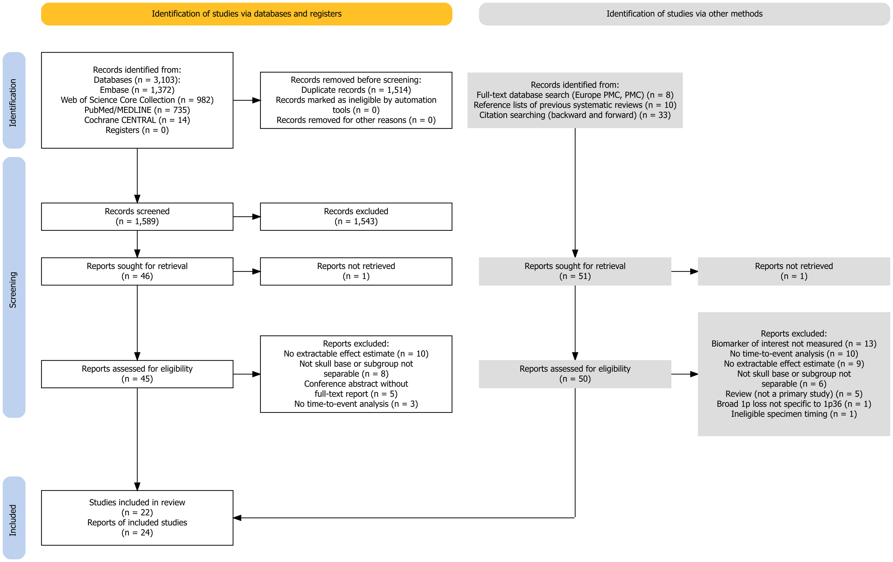

```{r setup}
suppressPackageStartupMessages({ library(metafor); library(DT); library(ggplot2) })
source("R/meta_analysis.R")
res <- run_meta_analysis(data_dir = "data", results_dir = "results")
e <- res$estimates
rd <- function(f) read.csv(file.path("data", f), stringsAsFactors = FALSE, check.names = FALSE, encoding = "UTF-8")
notes <- function(f) { x <- readLines(file.path("data", f), encoding = "UTF-8"); paste(x[nzchar(x)], collapse = "<br>") }
tab <- function(d, page = 10, ...) datatable(d, rownames = FALSE, filter = "top", extensions = "Buttons",
  options = list(pageLength = page, scrollX = TRUE, dom = "Bfrtip", buttons = c("copy", "csv"), autoWidth = TRUE), ...)
src_lab <- c(reported = "Reported", ci_from_p = "CI from p", ipd = "IPD", km_curve = "KM curve", log_rank = "Log-rank")
e$source_short <- unname(src_lab[e$source_code])
e$source_short[e$source_code == "reported" & is.na(e$ci_lower)] <- "CI from p"
nev <- function(n, ev) paste0(ifelse(is.na(n), "nr", n), " / ", ifelse(is.na(ev), "nr", ev))
S <- res$syntheses
```

This report reproduces every analysis of the systematic review and meta-analysis registered in PROSPERO (CRD420261390460). All pooled estimates, subgroup and sensitivity analyses, small-study-effect tests and forest plots are recomputed from `data/estimates.csv` by `R/meta_analysis.R` each time the report is rendered. The numbers therefore always reflect the current dataset. Tables can be filtered, sorted and copied.

# Main results

```{r main}
p <- S[S$hr_95ci != "Not pooled", ]
d <- data.frame(Biomarker = p$biomarker, Outcome = p$outcome, Analysis = p$analysis, k = p$k,
                `Patients / events` = paste0(p$patients, " / ", p$events, ifelse(p$cohorts_events_nr > 0, paste0(" + nr in ", p$cohorts_events_nr), "")),
                `HR (95% CI)` = p$hr_95ci, `Per 5 points` = ifelse(is.na(p$hr_per5_95ci), "", p$hr_per5_95ci),
                p = formatC(p$p, format = "f", digits = 3), `I², %` = round(p$i2),
                `95% PI` = paste0(f2(p$pi_lower), "–", f2(p$pi_upper)), check.names = FALSE)
knitr::kable(d, align = "lllcllllcl")
```

HR, hazard ratio for the higher biomarker category (binary) or per 1 percentage point of Ki-67 (continuous), with values above 1 indicating a worse prognosis. Pooled estimates come from random-effects models (restricted maximum likelihood estimate of τ²) with Hartung–Knapp–Sidik–Jonkman confidence intervals (ad hoc variance correction). PI, prediction interval; nr, not reported. A pooled estimate required at least three independent compatible cohorts; adjusted and unadjusted estimates and binary and continuous scales were never combined.

# Study selection

```{r prisma, out.width="85%", fig.align="center"}

```

```{r prisma-tab}
pc <- rd("prisma_counts.csv")
lab <- c(database_results = "Records from databases", database_specific_results = "Records by database", duplicates = "Duplicates removed",
         records_screened = "Records screened (title and abstract)", records_excluded = "Records excluded",
         dbr_sought_reports = "Database reports sought", dbr_notretrieved_reports = "Database reports not retrieved",
         dbr_assessed = "Database reports assessed in full text", dbr_excluded = "Database reports excluded (reasons)",
         website_results = "Other methods: full-text database search", organisation_results = "Other methods: reference lists of reviews",
         citations_results = "Other methods: citation searching", other_sought_reports = "Other-methods reports sought",
         other_notretrieved_reports = "Other-methods reports not retrieved", other_assessed = "Other-methods reports assessed in full text",
         other_excluded = "Other-methods reports excluded (reasons)", total_studies = "Studies included", total_reports = "Reports of included studies")
pc <- pc[pc$data %in% names(lab), ]
knitr::kable(data.frame(Step = unname(lab[pc$data]), n = pc$n, Details = pc$boxtext), align = "lcl")
```

All full-text reports excluded, with reasons:

```{r excluded}
x <- rd("excluded_reports.csv"); names(x) <- c("Report", "Identified via", "Reason for exclusion"); tab(x)
```

# Included studies

```{r chars}
x <- rd("study_characteristics.csv")
names(x) <- c("Study", "Country; centre(s)", "Period; design", "Skull base / total, n", "Age, years", "Children (<18 years), n (%)",
              "Male, n (%)", "Histology, conventional / chondroid", "Recurrent or previously treated at index surgery",
              "Gross or total resection, n (%)", "Radiotherapy, n (%)", "Follow-up, months", "Review biomarkers")
tab(x, page = 22)
```

<small>`r notes("study_characteristics_notes.txt")`</small>

## Assessment of the biomarkers

```{r assays}
x <- rd("biomarker_assessment.csv")
names(x) <- c("Study", "Biomarker", "Platform", "Antibody or probe", "Specimen", "n evaluable", "Scale and cut-off",
              "Origin of cut-off", "Positive, n (%)", "Use in the synthesis")
tab(x, page = 10)
```

<small>`r notes("biomarker_assessment_notes.txt")`</small>

# All extracted and derived estimates

Every eligible hazard ratio, with its source and its use in the syntheses (`r nrow(e)` estimates from `r length(unique(e$study_id))` studies).

```{r estimates}
x <- e[order(e$year, e$study, e$biomarker, e$outcome), ]
ci <- ifelse(!is.na(x$ci_lower), paste0(f2(x$hr), " (", f2(x$ci_lower), "–", f2(x$ci_upper), ")"),
             ifelse(!is.na(x$se_log_hr) & !is.na(x$hr), hr_ci(log(x$hr), log(x$hr) - 1.96 * x$se_log_hr, log(x$hr) + 1.96 * x$se_log_hr),
                    ifelse(is.na(x$hr), "No HR", paste0(f2(x$hr), " (CI nr)"))))
tab(data.frame(Study = x$study, Biomarker = x$biomarker, Outcome = x$outcome, Comparison = x$comparison, Adjustment = x$adjustment,
               n = x$n, Events = x$events, `HR (95% CI)` = ci, Source = x$source, `Use in the synthesis` = x$use,
               `Synthesis ID` = x$synthesis_id, `Estimate ID` = x$estimate_id, check.names = FALSE), page = 15)
```

# Meta-analyses

## Summary of all syntheses

```{r syn}
tab(data.frame(Biomarker = S$biomarker, Outcome = S$outcome, Analysis = S$analysis, k = S$k, Patients = S$patients,
               Events = S$events, `HR (95% CI)` = S$hr_95ci, `I², %` = round(S$i2), Note = S$reason,
               Studies = S$studies, `Synthesis ID` = S$synthesis_id, check.names = FALSE), page = 17)
```

## Forest plots

```{r forest-fun}
## axis marks on the HR scale that cover the confidence intervals and 1
nice_at <- function(li, ls) {
  cand <- c(0.01, 0.02, 0.05, 0.1, 0.2, 0.5, 0.8, 0.9, 1, 1.1, 1.25, 1.5, 2, 3, 5, 10, 20, 50, 100, 200, 500)
  lo <- max(min(c(li, 1), na.rm = TRUE), 0.01); hi <- min(max(c(ls, 1), na.rm = TRUE), 500)
  a <- cand[cand >= max(cand[cand <= lo]) & cand <= min(cand[cand >= hi])]
  if (diff(range(log(a))) > log(4)) a <- a[!(a %in% c(0.8, 0.9, 1.1, 1.25, 1.5))]
  a
}
forest_syn <- function(sid) {
  sc <- SYNTHESES[SYNTHESES$id == sid, ]
  dd <- synthesis_rows(e, sid)
  m <- res$models[[sid]]
  disp <- is.null(m)
  lab <- if (disp) paste0(dd$study, " – ", substr(dd$comparison, 1, 60), ifelse(grepl("^Adjusted", dd$adjustment), " (adjusted)", " (unadjusted)")) else dd$study
  il <- cbind(nev(dd$n, dd$events), dd$source_short)
  li <- ifelse(is.na(dd$ci_lower), exp(dd$yi - 1.96 * dd$sei), dd$ci_lower)
  ls <- ifelse(is.na(dd$ci_upper), exp(dd$yi + 1.96 * dd$sei), dd$ci_upper)
  at <- nice_at(li, ls); alim <- log(range(at)); W <- diff(alim)
  ## fractions of the plot width: study labels, n/events and source columns, plotting area, HR text
  fl <- if (disp) 0.46 else 0.24; fi <- 0.17; fp <- if (disp) 0.21 else 0.40; fr <- 0.16
  tot <- W / fp
  xlim <- c(alim[1] - tot * (fl + fi), alim[2] + tot * fr)
  ixp <- alim[1] - tot * c(fi * 0.72, fi * 0.22)
  if (!disp) {
    mm <- rma(yi = dd$yi, sei = dd$sei, slab = lab, method = "REML", test = "adhoc")
    forest(mm, atransf = exp, at = log(at), alim = alim, xlim = xlim, ilab = il, ilab.xpos = ixp, ilab.lab = c("n / events", "Source"),
           header = c("Study", "HR [95% CI]"), addpred = TRUE, xlab = sc$scale, cex = 0.95, digits = c(2, 2),
           mlab = paste0("Random effects (I² = ", round(mm$I2), "%)"))
  } else {
    forest(x = dd$yi, ci.lb = log(li), ci.ub = log(ls), slab = lab, atransf = exp, at = log(at), alim = alim, xlim = xlim,
           ilab = il, ilab.xpos = ixp, ilab.lab = c("n / events", "Source"), header = c("Study", "HR [95% CI]"),
           refline = 0, xlab = sc$scale, cex = 0.95, digits = c(2, 2))
  }
}
h_of <- function(sid) 1.9 + 0.3 * nrow(synthesis_rows(e, sid))
```

Squares, study estimates (size proportional to weight in pooled syntheses); horizontal lines, 95% confidence intervals as reported or computed from the standard error; diamond, pooled estimate; dashed line, 95% prediction interval. Source: Reported, HR and 95% CI reported by the authors; CI from p, CI derived from the reported p value; IPD, Cox model fitted to individual patient data (Firth's correction when all events occurred in one group); KM curve, reconstructed Kaplan–Meier curve; Log-rank, derived from the log-rank p value and events (Tierney method).

```{r forests, results="asis", fig.width=10}
for (sid in SYNTHESES$id) {
  sc <- SYNTHESES[SYNTHESES$id == sid, ]; s <- S[S$synthesis_id == sid, ]
  cat("\n\n### ", sc$biomarker, ": ", tolower(sc$outcome), " – ", sc$analysis, "\n\n", sep = "")
  if (s$hr_95ci != "Not pooled") {
    cat("Pooled HR ", s$hr_95ci, "; p = ", formatC(s$p, format = "f", digits = 3), "; I² = ", round(s$i2), "%; τ² = ",
        formatC(s$tau2, format = "f", digits = 4), "; 95% prediction interval ", f2(s$pi_lower), "–", f2(s$pi_upper),
        if (!is.na(s$hr_per5_95ci)) paste0("; per 5 percentage points ", s$hr_per5_95ci) else "", ".\n\n", sep = "")
  } else cat("No pooled estimate: ", s$reason, ".\n\n", sep = "")
  tf <- tempfile(fileext = ".png"); png(tf, width = 11, height = h_of(sid), units = "in", res = 130); forest_syn(sid); dev.off()
  cat(", ")\n\n", sep = "")
}
```

# Subgroup analysis by Ki-67 cut-off

Binary Ki-67, unadjusted and derived HRs; cut-offs around 5% (4–6%) versus other values, tested with random-effects meta-regression. Subgroups with fewer than three cohorts are described without inference. The adjusted (primary) synthesis was not divided, because only one cohort used a cut-off outside 4–6%.

```{r sub}
x <- res$subgroups
knitr::kable(data.frame(Synthesis = ifelse(grepl("PFS", x$synthesis_id), "Recurrence/progression", "Overall survival"),
                        Subgroup = x$level, k = x$k, `HR (95% CI)` = x$hr_95ci, `I², %` = x$i2,
                        `p for subgroup difference` = formatC(x$p_subgroup_difference, format = "f", digits = 3),
                        Note = x$note, Studies = x$studies, check.names = FALSE))
```

# Sensitivity analyses

```{r sens}
x <- res$sensitivity
nm <- setNames(paste0(S$biomarker, ", ", tolower(S$outcome), " – ", S$analysis), S$synthesis_id)
main <- S[S$synthesis_id %in% unique(x$synthesis_id), ]
x <- rbind(data.frame(synthesis_id = main$synthesis_id, analysis = "Main analysis (REML, Hartung–Knapp–Sidik–Jonkman)", k = main$k,
                      hr_95ci = main$hr_95ci, i2 = round(main$i2), studies = ""), x)
x <- x[order(match(x$synthesis_id, SYNTHESES$id)), ]
tab(data.frame(Synthesis = unname(nm[x$synthesis_id]), Analysis = x$analysis, k = x$k, `HR (95% CI)` = x$hr_95ci,
               `I², %` = ifelse(is.na(x$i2), "–", x$i2), check.names = FALSE), page = 25)
```

# Small-study effects

Assessed only in syntheses with at least `r MIN_K_EGGER` cohorts: contour-enhanced funnel plot (contours at p = 0.10, 0.05 and 0.01) and Egger's regression test with the standard error as predictor; the limit estimate is the predicted HR as the standard error tends to zero.

```{r funnel, fig.width=7, fig.height=5.5}
x <- res$small_study_effects
for (sid in x$synthesis_id) {
  m <- res$models[[sid]]
  funnel(m, level = c(90, 95, 99), shade = c("white", "gray90", "gray80"), back = "gray70", refline = 0,
         legend = list(show = "pvals"), atransf = exp, xlab = SYNTHESES$scale[SYNTHESES$id == sid], ylab = "Standard error of log HR")
  title(paste0(SYNTHESES$biomarker[SYNTHESES$id == sid], ", ", tolower(SYNTHESES$outcome[SYNTHESES$id == sid]), " (k = ", x$k[x$synthesis_id == sid], ")"), cex.main = 0.95, font.main = 1)
}
knitr::kable(data.frame(Synthesis = unname(nm[x$synthesis_id]), k = x$k, `Egger z` = round(x$egger_z, 2),
                        `Egger p` = formatC(x$egger_p, format = "f", digits = 3), `Limit estimate (95% CI)` = x$limit_estimate_95ci, check.names = FALSE))
```

# Risk of bias (QUIPS)

Each combination of study, biomarker and estimate class was assessed in six domains. Unadjusted estimates are at high risk for D5 (confounding) by rule, and their overall rating is computed without D5.

```{r rob-plot, fig.width=9, fig.height=4.5}
q <- rd("risk_of_bias_quips.csv")
long <- function(out) {
  d4 <- if (out == "Recurrence or progression") q$d4_outcome_recurrence else q$d4_outcome_survival
  d6 <- if (out == "Recurrence or progression") q$d6_analysis_recurrence else q$d6_analysis_survival
  ov <- if (out == "Recurrence or progression") q$overall_recurrence else q$overall_survival
  ok <- d4 != ""
  dom <- list("D1 Study participation" = q$d1_participation, "D2 Study attrition" = q$d2_attrition,
              "D3 Prognostic factor measurement" = q$d3_prognostic_factor, "D4 Outcome measurement" = d4,
              "D5 Study confounding" = q$d5_confounding, "D6 Statistical analysis and reporting" = d6, "Overall" = ov)
  do.call(rbind, lapply(names(dom), function(k) data.frame(outcome = out, domain = k, rating = dom[[k]][ok])))
}
rb <- rbind(long("Recurrence or progression"), long("Survival"))
rb$rating <- factor(tools::toTitleCase(rb$rating), levels = c("High", "Moderate", "Low"))
rb$domain <- factor(rb$domain, levels = rev(unique(rb$domain)))
ggplot(rb, aes(y = domain, fill = rating)) + geom_bar(position = "fill", width = 0.7) + facet_wrap(~ outcome) +
  scale_x_continuous(labels = scales::percent) + labs(x = "Assessments", y = NULL, fill = "Risk of bias") +
  scale_fill_manual(values = c(High = "#D9534F", Moderate = "#F0AD4E", Low = "#5CB85C")) + theme_minimal(base_size = 11) +
  theme(legend.position = "bottom")
```

## Ratings of each assessment

```{r rob-tab}
r <- c("d1_participation", "d2_attrition", "d3_prognostic_factor", "d4_outcome_recurrence", "d4_outcome_survival", "d5_confounding",
       "d6_analysis_recurrence", "d6_analysis_survival", "overall_recurrence", "overall_survival")
x <- data.frame(Assessment = paste0(q$study, ", ", q$biomarker, " (", tolower(q$adjustment), ")"), q[, r], check.names = FALSE)
x[] <- lapply(x, function(v) { v[v == ""] <- "–"; v })
names(x) <- c("Assessment", "D1", "D2", "D3", "D4 recurrence", "D4 survival", "D5", "D6 recurrence", "D6 survival", "Overall recurrence", "Overall survival")
tab(x, page = 40) |> formatStyle(names(x)[-1], backgroundColor = styleEqual(c("low", "moderate", "high"), c("#C6EFCE", "#FFEB9C", "#FFC7CE")))
```

## Justification of each judgement

```{r rob-just}
x <- data.frame(Assessment = paste0(q$study, ", ", q$biomarker, " (", tolower(q$adjustment), ")"),
                D1 = q$d1_justification, D2 = q$d2_justification, D3 = q$d3_justification, D4 = q$d4_justification,
                D5 = q$d5_justification, D6 = q$d6_justification)
tab(x, page = 5)
```

<small>Tables and figures cited in the justifications are those of the source article.</small>

# Certainty of evidence (GRADE)

## Summary of findings

```{r sof}
x <- rd("summary_of_findings.csv")
for (i in seq_len(nrow(x))) {
  sid <- x$synthesis_id[i]; if (!nzchar(sid)) next
  s <- S[S$synthesis_id == sid, ]
  x$k_n_events[i] <- paste0(s$k, " (", s$patients, " / ", s$events, if (s$cohorts_events_nr > 0) paste0(" + nr in ", s$cohorts_events_nr) else "", ")")
  x$effect[i] <- paste0(s$hr_95ci, if (!is.na(s$hr_per5_95ci)) paste0("; per 5 points ", s$hr_per5_95ci) else "")
  x$heterogeneity[i] <- paste0("I² ", round(s$i2), "%; PI ", f2(s$pi_lower), "–", f2(s$pi_upper))
}
tab(data.frame(`Biomarker (scale)` = x$biomarker, Outcome = x$outcome, Analysis = x$analysis, `k (patients / events)` = x$k_n_events,
               `HR (95% CI)` = x$effect, Heterogeneity = x$heterogeneity, `Reasons for downgrading` = x$downgrading,
               Certainty = x$certainty, `Summary statement` = x$statement, check.names = FALSE), page = 15)
```

<small>`r notes("summary_of_findings_notes.txt")`</small>

## Evidence profile

```{r grade}
x <- rd("grade_evidence_profile.csv")
names(x) <- c("Comparison", "Starting certainty", "Risk of bias", "Inconsistency", "Indirectness", "Imprecision", "Publication bias", "Upgrading", "Certainty")
tab(x, page = 15)
```

<small>`r notes("grade_evidence_profile_notes.txt")`</small>

# Reproducibility

The report was rendered with `r R.version.string`, metafor `r packageVersion("metafor")`, DT `r packageVersion("DT")` and ggplot2 `r packageVersion("ggplot2")`. To reproduce it, install R (version 4.3 or later), the packages metafor, DT, ggplot2, knitr and rmarkdown, and Quarto, then run `quarto render index.qmd` in the repository folder. The analysis alone can be run with `Rscript R/meta_analysis.R`, which writes the tables in `results/`.
